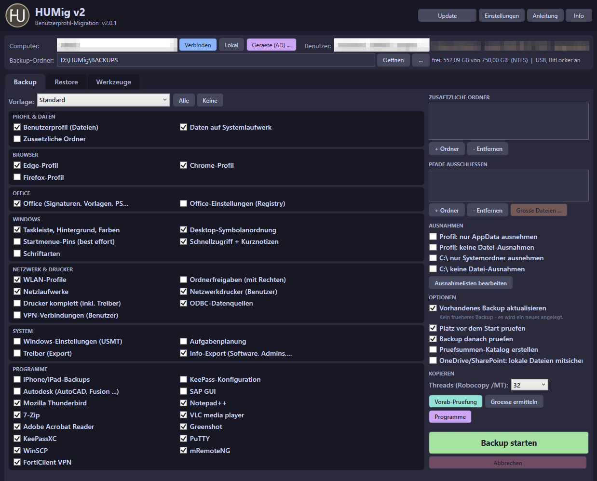
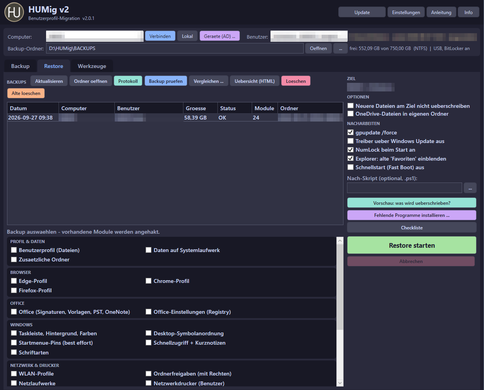
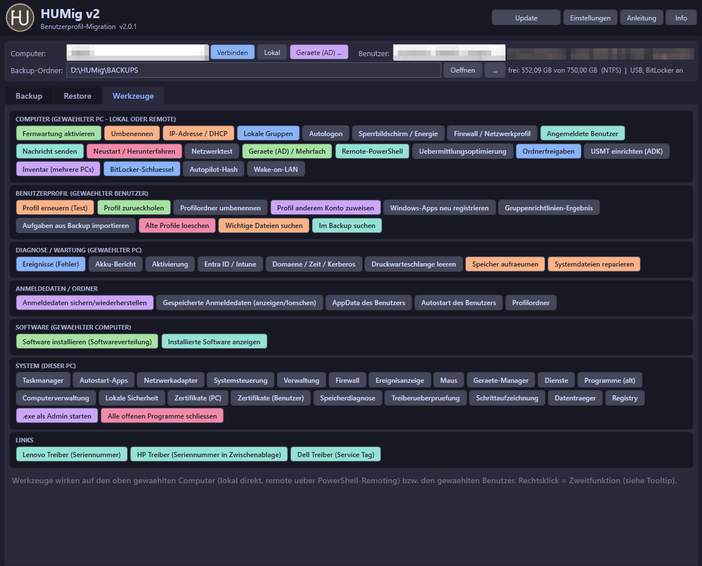

<h1 align="center"> HUMig v2</h1>

<p align="center"><b>Benutzerprofil-Migration, PC-Werkzeuge und Hyper-V-Server-Backup für Windows</b><br>
Profile sichern und auf denselben oder einen neuen PC zurückspielen – per USB-Laufwerk oder über das Netzwerk.<br>
Hyper-V-VMs und Host auf rotierende USB-Platten sichern – mit Zeitplan, Prüfung und Verlauf.</p>

<p align="center">
  <a href="https://github.com/ChiliApple/HUMig/releases/latest"></a>
  
  
  
  
  <a href="LICENSE"></a>
</p>

<p align="center">
  <a href="https://chiliapple.github.io/HUMig/Docs/Einstieg.html"><b>Einstieg: Was mache ich damit?</b></a> ·
  <a href="https://chiliapple.github.io/HUMig/Docs/Funktionen.html"><b>Funktionen im Überblick</b></a> ·
  <a href="https://chiliapple.github.io/HUMig/Docs/Anleitung.html"><b>Anleitung</b></a> ·
  <a href="INSTALL.md">Installation</a> ·
  <a href="CHANGELOG.md">Änderungen</a> ·
  <a href="LICENSE">Lizenz</a>
</p>

<table>
  <tr>
    <td align="center"><a href="Docs/img/backup.png"></a><br><sub>Backup</sub></td>
    <td align="center"><a href="Docs/img/restore.png"></a><br><sub>Restore</sub></td>
    <td align="center"><a href="Docs/img/werkzeuge.png"></a><br><sub>Werkzeuge</sub></td>
  </tr>
</table>

---

## Schnellstart

PowerShell **als Administrator** öffnen und einfügen:

```powershell
irm https://github.com/ChiliApple/HUMig/releases/latest/download/Install.ps1 | iex
```

Fragt nach dem Zielordner (Vorschlag `C:\Program Files\HUMig`), lädt die freigegebene Version, prüft jede Datei (Prüfsumme und Signatur) und startet HUMig. Was die Zeile genau tut: [Install.ps1](Install.ps1). Ohne Einzeiler: `Pull.ps1` in einen leeren Ordner legen und starten – siehe [INSTALL.md](INSTALL.md).

Danach: Computer und Benutzer wählen → Reiter **Backup** → **Backup starten**.

Was das Programm kann und wie es geht:

- [Einstieg](https://chiliapple.github.io/HUMig/Docs/Einstieg.html) – typische Situationen aus dem Alltag
- [Funktionen](https://chiliapple.github.io/HUMig/Docs/Funktionen.html) – alles auf einer Seite
- [Anleitung](https://chiliapple.github.io/HUMig/Docs/Anleitung.html) – Schritt für Schritt, im Programm mit **F1**

---

**Lizenz:** kostenlose Nutzung erlaubt, Veränderung und Weitergabe veränderter Fassungen nicht – Details in [LICENSE](LICENSE) (deutsch und englisch).
*License: free to use, modification and redistribution of modified versions not permitted – see [LICENSE](LICENSE) (German and English).*
